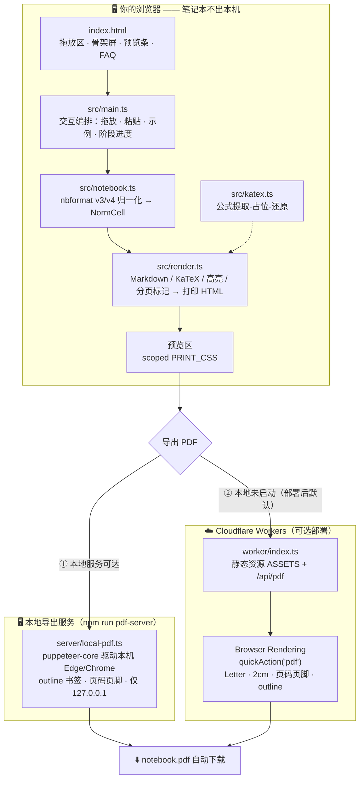
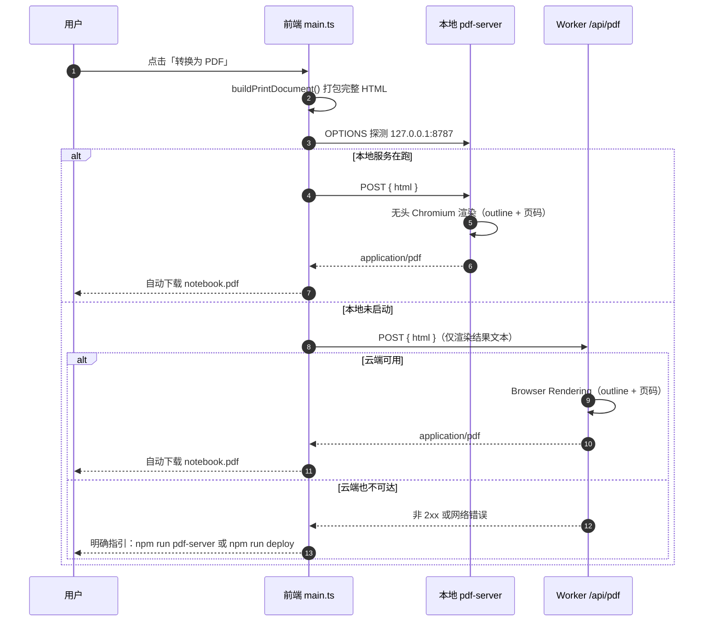

<div align="center">

# 📓 ipynb-to-pdf

**把 Jupyter Notebook 转成中文不乱码的 PDF —— 笔记本文件不出你的浏览器**

*No more tofu boxes □□□ — Jupyter → PDF with first-class CJK support* / TypeScript · Vite · KaTeX · Cloudflare Workers

[](https://www.typescriptlang.org/)
[](https://vite.dev/)
[](https://developers.cloudflare.com/workers/)
[](https://katex.org/)
[](./LICENSE)

[快速开始](#-快速开始) · [架构总览](#-架构总览) · [设计支柱](#-设计支柱) · [核心机制](#-核心机制) · [项目结构](#-项目结构)

</div>

---

## 🎯 这是什么

一份用中文写的 Jupyter 课件/讲义，想转成 PDF 分享，结果：

- `nbconvert` + LaTeX 路线要装 TeX 发行版，中文字体一配错就满屏 **□□□**；
- 在线转换工具要求上传笔记本，课件里可能有不想外传的内容；
- 课件里老师留下的内嵌 HTML（`<font color>`、`<center>`、`<style>`）经常被转没了。

**ipynb-to-pdf 把渲染全部搬进你的浏览器**：拖入 `.ipynb` 即时预览，一键导出 PDF。
因为没有 LaTeX、没有字体子集化环节，正文直接走你本机的中文字体栈，中文天然不乱码；
解析和渲染不离开本机，云端导出（可选）发送的也只是渲染完成的 HTML 文本。

> 它不装 TeX，不装 nbconvert，不上传你的笔记本。
> 转换不运行任何代码——只渲染笔记本里**已经保存**的输出。

> 🌐 在线试用（维护者自建实例）：<https://ipynb-to-pdf.cc.cd> —— 不装任何东西，拖进去就能转。

## 🏛️ 设计支柱

| 支柱 | 怎么做到的 | 落点 |
|---|---|---|
| 🀄 **中文不乱码** | 渲染在本机浏览器完成，`font-family` 走 PingFang SC / Microsoft YaHei / Noto Sans CJK SC 栈，无字体子集化环节 | `src/render.ts` 的 `PRINT_CSS` |
| 🎨 **Jupyter 原味** | markdown 内嵌 HTML 直通（经 DOMPurify 白名单净化，经典标签保留、脚本剔除）、`In [n]:` 提示符、经典 CodeMirror 配色、输出区独立列 | `src/render.ts` |
| 🔒 **隐私优先** | 解析与渲染全在浏览器；云端导出只上传渲染后的 HTML 文本（不传原始笔记本），且走你自己部署的 Worker | `src/main.ts` · `index.html` FAQ |
| 🛟 **永不卡死** | 双引擎路由：本地服务 → 云端 Worker 自动选择，全程无打印对话框；两路都不可用时给出明确启动指引 | `src/main.ts` 的 `convertToPdf()` |

## ✨ 功能全景

- 📄 **nbformat v3/v4 双格式归一化** — 老 Anaconda 导出的 v3 笔记本也能转，下游只见一种中间表示（`src/notebook.ts` 的 `parseNotebook`）
- 📝 **GFM Markdown 全要素 + 内嵌 HTML 直通** — 表格、任务列表、`<font>`/`<center>`/`<style>` 原样生效，对齐 Jupyter 行为（`src/render.ts` 的 `markdown-it { html: true }`）
- 🧮 **KaTeX 数学公式** — `$…$` 行内与 `$$…$$` 块级，公式先抽成占位符再还原，不会被 markdown 规则吃掉（`src/katex.ts`）
- 🎨 **代码高亮 + `In [n]:` 提示符** — highlight.js 经典配色，`ipython/sh/console` 等别名自动映射（`src/render.ts` 的 `highlightCode`）
- 🖼️ **图片全收** — nbformat 附件（`attachment:`）、matplotlib base64 输出、OSS/图床外链全部进 PDF（`src/notebook.ts` 的 `normalizeAttachments`）
- 📑 **分页标记识别与消费** — `<!-- CELL_BREAK -->` 不再原样显示；v1.2 起不再强制换页，长文档按段落自然续排，页尾大留白根除（`src/render.ts` 的 `injectPageBreaks`）
- 🧯 **ANSI 控制序列清洗** — stream 输出只留可读文本（`src/notebook.ts` 的 `stripAnsi`）
- 🪄 **交互式 widget 自动跳过** — 计数并提示"N 个 widget 无法进入 PDF"，其余内容正常渲染（`src/notebook.ts` 的 `WidgetCounter`）
- 🖱️ **全窗口拖放 + Ctrl+V 粘贴 + 内置示例** — 任意位置松手即预览，`?example=1` 一键自检（`src/main.ts`）
- ⚡ **双引擎一键导出，无打印对话框** — 本地服务（`npm run pdf-server`，无头 Chromium）优先，云端 Worker 兜底；本地转换失败自动回退云端；PDF 均带侧边栏书签大纲 + 页脚页码（`src/main.ts` · `server/local-pdf.ts` · `worker/index.ts`）

## 🏗️ 架构总览



**导出链路时序**（含兜底分支）：



## 🧰 技术栈

| 分类 | 技术 | 用途 |
|---|---|---|
| 语言 / 构建 | TypeScript 5 · Vite 7（**无框架**，零运行时 UI 依赖） | 前端单页与 Worker 同栈开发 |
| Markdown | markdown-it 14（`html: true`） | GFM 渲染 + 内嵌 HTML 直通 |
| 公式 | KaTeX 0.16 | `$…$` / `$$…$$` 排版 |
| 高亮 | highlight.js 11（common 包） | 代码单元格语法高亮 |
| 安全 | DOMPurify 3 | 输出区 / 内嵌 HTML 白名单净化（markdown 单元同样过净化，脚本/事件属性剔除） |
| 图标 | @phosphor-icons/web | UI 图标 |
| 本地导出 | puppeteer-core + tsx | 驱动本机 Edge/Chrome 无头渲染（`npm run pdf-server`） |
| 云端导出 | Cloudflare Workers + Browser Rendering + Workers Assets | `/api/pdf` 无头渲染 + 静态托管 |
| 验收 | jsdom（仅 devDependency） | Node 端复用渲染逻辑做验收，不进构建产物 |

## 🚀 快速开始

### 0️⃣ 环境要求

| 组件 | 版本要求 | 说明 |
|---|---|---|
| Node.js | ≥ 20.19（Vite 7 的要求） | npm 随 Node 附带 |
| Cloudflare 账号 | 可选 | 仅「一键云端导出」需要；不用它照样能导出 |

### 1️⃣ 安装

```bash
npm install
```

### 2️⃣ 本地体验

<!-- CC: 新增：v3 已移除浏览器打印兜底，本地使用必须同时挂起前端与 pdf-server 两个进程 -->
本地使用需要**两个终端、两条命令同时挂着**——这是最容易踩的坑，缺一个就导不出 PDF：

```bash
# 终端 1：前端页面（解析、预览、发起导出）
npm run dev           # 打开 http://localhost:5173

# 终端 2：本地 PDF 导出服务（无头 Chromium，仅监听 127.0.0.1:8787）
npm run pdf-server
```

> ⚠️ **为什么缺一不可**：`npm run dev` 只有前端，不含任何 PDF 引擎。点「转换为 PDF」走「本地服务 → 云端 Worker」双引擎路由，而云端接口 `/api/pdf` 是**相对路径**，只有部署后的 Worker 页面才有这个后端——本地 dev 页面调它必然失败。所以纯本地场景下 `pdf-server` 就是唯一的导出引擎，不启动它只会得到「PDF 引擎不可用」的提示（旧版的浏览器打印兜底已在 v3 移除）。
>
> 💡 `pdf-server` 启动后**常驻后台**，终端出现 `http://127.0.0.1:8787` 即就绪；首次转换时自动拉起本机 Edge/Chrome 无头实例（不需要装 TeX / Playwright），之后复用同一实例。它只绑定回环地址，不对局域网开放。

### 3️⃣ 部署到 Cloudflare（可选，约 5 分钟）

<!-- CC: 新增：个人使用 + Cloudflare 部署的完整步骤、额度说明与跨平台注意 -->
部署之后你得到一个**随处可访问的网址 + 云端 PDF 引擎**：换电脑、用手机、发给同学用，都不再依赖本地服务和本机浏览器。个人使用全程免费，不需要绑卡。

**第 1 步 · 注册 Cloudflare 账号**

打开 [dash.cloudflare.com](https://dash.cloudflare.com/sign-up) 用邮箱注册（免费）。Workers 免费档每天 10 万次请求额度，本项目导出消耗的是 Browser Rendering 的浏览器时长（额度见第 4 步说明）。

**第 2 步 · 登录 Wrangler**

```bash
npx wrangler login     # 首次执行会弹出浏览器授权页，点 Allow
npx wrangler whoami    # 验证登录成功，能看到账号邮箱与 account_id
```

> 💡 **多账号注意**：如果你的邮箱名下有多个 Cloudflare Account（比如加入过他人的组织），`wrangler deploy` 会交互式询问选哪个，非交互终端则直接报错。先 `npx wrangler whoami` 找到目标 `account_id`，再用环境变量固定：
>
> ```bash
> # PowerShell
> $env:CLOUDFLARE_ACCOUNT_ID = "你的account_id"
> # macOS / Linux
> export CLOUDFLARE_ACCOUNT_ID=你的account_id
> ```

**第 3 步 · 构建并部署**

```bash
npm run deploy         # = vite build + wrangler deploy
```

成功时输出形如：

```text
Uploaded ipynb (1.2 sec)
Published ipynb (0.8 sec)
  https://ipynb.<你的子域>.workers.dev
```

**第 4 步 · 验证部署**

1. 打开 `https://ipynb.<你的子域>.workers.dev/?example=1` — 内置示例能正常预览，说明静态资源正常；
2. 点 **转换为 PDF** — 状态栏走完「发送 HTML → 浏览器渲染 → 生成 PDF」三阶段并自动下载，说明云端引擎正常；
3. 打开 Cloudflare 控制台 → **Workers & Pages** → `ipynb`，可查看每次导出的调用记录与日志。

**第 5 步 ·（可选）绑定自己的域名**

`*.workers.dev` 在部分网络下不可达，给同学/学生一个稳定好记的地址更靠谱：Cloudflare 控制台 → **Workers & Pages** → `ipynb` → **Settings → Domains & Routes → Add → Custom domain**，填你的域名（该域名的 DNS 需已托管在同一账号），状态变成 Active 即可。

- 自定义域是**独立于部署**的绑定：之后 `npm run deploy` 原地覆盖同名 Worker，绑定不会掉；
- 维护者的线上实例就是 `https://ipynb-to-pdf.cc.cd`（Workers 名 `ipynb` + 自定义域），可直接对照效果；
- 不建议把自定义域写进 `wrangler.json` 的 `routes`：别人 fork 后没有这个域名，`npm run deploy` 会直接失败。

**额度与更新**：

- **Browser Rendering 免费额度 = 每天 10 分钟浏览器时长**（UTC 0 点重置）。超限后 `/api/pdf` 返回 `429`，前端会明确提示「云端浏览器时长已用完，次日自动恢复」，不会静默失败；急用可临时切本地 `npm run pdf-server`。个人一天转几十份课件都用不完；要更多可升级 Workers Paid（每月含 10 小时）。
- **以后更新**：改完代码再跑一次 `npm run deploy`，同名 Worker 原地覆盖，网址（含自定义域）不变。
- **回滚**：Cloudflare 控制台该 Worker 的 **Deployments** 里可一键回退旧版本。

<details>
<summary><b>🔧 想在本地起完整 Worker 调试？</b>（点击展开）</summary>

```bash
npm run build
npx wrangler dev       # 本地起 Worker：静态资源 + /api/pdf 一并可用
```

<!-- CC: 新增：远程代理行为、账号歧义与端口冲突说明 -->
注意三点：

- Browser Rendering 绑定在本地**通过远程代理连接真实云端浏览器**——本地调试同样消耗账号每日时长额度，且需保持 `wrangler login` 状态；
- 账号下有多个 Account 时必须设置 `CLOUDFLARE_ACCOUNT_ID`（见第 2 步），否则会卡在 `Establishing remote connection...` 或报账号歧义；
- `wrangler dev` 默认占用 **8787** 端口，与 `pdf-server` 冲突：同时要跑两者时先停掉一个，或 `npx wrangler dev --port 8788` 换端口。

</details>

<details>
<summary><b>🐧 macOS / Linux 用户：本地引擎需补一处浏览器路径</b>（点击展开）</summary>

<!-- CC: 新增：跨平台说明 -->
`server/local-pdf.ts` 的 `CANDIDATES` 数组硬编码的是 Windows 的 Edge/Chrome 路径，其它系统启动 `npm run pdf-server` 会报「未找到 Edge/Chrome」。把本机浏览器路径加进数组即可：

```ts
const CANDIDATES = [
  // …原有 Windows 路径保留…
  // macOS
  '/Applications/Google Chrome.app/Contents/MacOS/Google Chrome',
  '/Applications/Microsoft Edge.app/Contents/MacOS/Microsoft Edge',
  // Linux
  '/usr/bin/google-chrome',
  '/usr/bin/microsoft-edge',
];
```

不想动代码也可以只用云端：部署后一切导出都走 Worker，与本地浏览器无关。

</details>

### 4️⃣ 体验核心链路

1. 打开页面，把任意 `.ipynb` 拖到**窗口任意位置**（或 `Ctrl+V` 粘贴文件，或点击选择）
2. 检查预览：单元格统计、页数估算；若有交互式 widget 会提示跳过数量
3. 点 **转换为 PDF**：本地服务在跑则直接由无头 Chromium 生成（带侧边栏书签 + 页码页脚）→ 自动下载；未启动则走云端 Worker
4. 都不可用时按提示执行 `npm run pdf-server`（本地）或 `npm run deploy`（云端）后重试
5. 访问 `http://localhost:5173/?example=1` 用内置示例自检全流程

## ⚙️ 配置说明

| 配置 | 位置 | 默认值 | 说明 |
|---|---|---|---|
| Worker 名称 | `wrangler.json` | `ipynb` | 决定 `*.workers.dev` 子域；自定义域与它解耦 |
| 静态资源绑定 `ASSETS` | `wrangler.json` | `./dist` | `vite build` 产物目录 |
| 浏览器绑定 `BROWSER` | `wrangler.json` | BrowserRun | `/api/pdf` 的无头浏览器 |
| 纸张 / 边距 | `worker/index.ts` 的 `PDF_OPTIONS` 与 `src/render.ts` 的 `PAGE_OPTIONS` | Letter / 2cm | **两处需保持一致**（云端与 @page 对齐） |
| 页脚页码 | `worker/index.ts` 的 `footerTemplate` | 第 X 页 / 共 Y 页 | 页眉为空 |
| 请求体上限 | `worker/index.ts` | 25 MB HTML | 超限返回 413，提示拆分笔记本 |
| 本地服务端口 | 环境变量 `PDF_SERVER_PORT` | `8787` | 被占用时服务会打印解决办法后退出（EADDRINUSE） |

💡 **最低可用配置**：什么都不用改。本地 `npm run pdf-server`（一次性后台挂着）即可覆盖全部导出需求；云端部署只是锦上添花。

## 🩺 常见问题（运维级）

- **`EADDRINUSE: 127.0.0.1:8787`**：上一次的 pdf-server 还在跑。PowerShell 一行清理：
  `Get-NetTCPConnection -LocalPort 8787 | Select -Expand OwningProcess | % { Stop-Process -Id $_ -Force }`
  或换端口重启：`$env:PDF_SERVER_PORT=8788; npm run pdf-server`
- **点了转换没反应/报引擎不可用**：本地服务未启动且云端未部署。先 `npm run pdf-server`，看终端出现 `http://127.0.0.1:8787` 即就绪。
- **本地服务明明在跑，却报「本地引擎出错 / Connection closed」**：pdf-server 的无头浏览器被关掉或崩了（休眠、系统回收、手动关窗都会）。v1.2 起服务会自动拉起新浏览器，重试一次即可；更早的版本请重启 `npm run pdf-server`。
- **转换卡住很久**：导出请求现在有超时（本地 180s / 云端 60s），超时会回报「等待超时」并恢复按钮；网络抖动时重试即可。
- **本地 dev 页面报引擎不可用，但我已经部署了 Worker**：部署的 Worker 只服务于它自己的 `*.workers.dev` 域名（或你绑定的自定义域），本地 `localhost:5173` 页面里的 `/api/pdf` 是相对路径，请求到不了云端。本地使用请启动 `npm run pdf-server`——本地与云端是两条独立的导出引擎。 <!-- CC: 新增 -->
- **云端转换报 `429 Browser time limit exceeded`**：Browser Rendering 免费档每日 10 分钟浏览器时长已用完（UTC 0 点重置，次日自动恢复）；急用可切本地 `npm run pdf-server`，或升级 Workers Paid。 <!-- CC: 新增 -->
- **`CELL_BREAK` 不再分页了？**：这是 v1.2 的有意变更——强制换页会在页尾留下大片空白。现在标记只被识别并消费，长文档按内容自然续排。
- **首次转换慢（10 秒上下）**：45 张 OSS 外链图要真实下载进 PDF，属正常；同一文档第二次转换会命中浏览器缓存。

## 🔬 核心机制

### 1️⃣ 为什么中文不会变成 □□□

传统 `nbconvert → LaTeX → PDF` 路径要经过字体子集化，中文字体一缺失就是空白方块。本项目全程走 **HTML/CSS 渲染路径**：正文、代码、公式都是 DOM，字体由一段 CSS 决定（`src/render.ts` → `PRINT_CSS`）：

```css
font-family: -apple-system, "Segoe UI", "Helvetica Neue", "PingFang SC",
  "Hiragino Sans GB", "Microsoft YaHei", "Noto Sans CJK SC", "Source Han Sans SC", sans-serif;
```

渲染发生在你本机浏览器，这些字体你机器上一定有——所以「天然不乱码」。

### 2️⃣ 公式为什么不会被 markdown 吃掉

markdown 规则会把 `$E = mc^2$` 里的 `_`、`*` 当成强调语法。`src/katex.ts` 在 markdown-it 之前插入一道管线（注意顺序：**还原保护段发生在数学抽取之后**，这样围栏代码块里的 `$HOME` 这类文本永远不会被误当公式）：

```
原始 markdown
  → maskProtected()：围栏代码块 / 行内代码 / HTML 注释换成临时占位
  → 在屏蔽文本上把 $$…$$ 与 $…$ 抽成占位符 xmathrulez<idx>xmathrulez
  → unmask()：保护段原样放回（围栏里的 $ 原封不动）
  → markdown-it 正常渲染（公式占位符是普通文本，谁也动不了它）
  → restore()：占位符还原为 KaTeX HTML，失败则显示红色代码兜底
```

### 3️⃣ 内嵌 HTML 怎么做到「原味又安全」

`markdown-it` 开 `html: true` 让课件的 `<font>`/`<center>`/`<style>` 直通（Jupyter 行为）；随后**所有**进入文档的动态内容（markdown 单元内的内嵌 HTML、输出区 HTML、SVG、公式产物）过一遍 **DOMPurify 白名单**（`src/render.ts` → `sanitize`）：

- 保留课件常用的 legacy 属性：`align` / `face` / `color` / `bgcolor`…
- 剔除打印场景无意义且有风险的东西：`script` / `iframe` / `object` / `embed` / `form` 与 `onerror` 类内联事件

### 4️⃣ 双路导出，永不断头

云端路径把渲染好的完整 HTML POST 到你自己部署的 Worker（`worker/index.ts`），由 Browser Rendering 的 `quickAction("pdf")` 无头渲染成 Letter 纸张 + 2cm 边距 + 中文页码页脚 + **侧边栏书签大纲**（`outline: true`）的 PDF 流式返回。本地路径（`server/local-pdf.ts`）用 puppeteer-core 驱动本机 Edge/Chrome 出同规格 PDF，不吃 CF 额度；本地探测通过但转换失败时自动回退云端。导出 HTML 内嵌完整 KaTeX 样式（`src/katex-print-css.ts`，由 `scripts/sync-katex-css.mjs` 生成），无头引擎不经过 Vite 也不会公式碎裂。任何一环失败，前端给出明确启动指引——**没有打印对话框，没有死胡同**。

## 📁 项目结构

```text
ipynb-to-pdf/
├── index.html            # 单页 UI：拖放区 / 骨架屏 / 预览条 / FAQ 折叠
├── src/
│   ├── main.ts           # 页面编排：拖放·粘贴·示例·双引擎路由（本地服务→云端）
│   ├── notebook.ts       # .ipynb 解析：nbformat v3/v4 归一化 + ANSI 清洗 + widget 计数
│   ├── render.ts         # 渲染核心：markdown/KaTeX/高亮/分页标记 + Jupyter 原味 PRINT_CSS
│   ├── katex.ts          # 公式「提取-占位-还原」管线，防 markdown 吞公式
│   ├── katex-print-css.ts # 自动生成：导出 HTML 内嵌的 KaTeX 样式（scripts/ 再生成）
│   ├── node-render.ts    # 验收专用入口（jsdom 顶替 DOM），不进构建产物
│   └── vite-env.d.ts     # Vite 类型声明
├── server/
│   └── local-pdf.ts      # 本地 PDF 导出服务：puppeteer-core 驱动本机 Edge/Chrome（仅 127.0.0.1）
├── worker/
│   └── index.ts          # Cloudflare Worker：静态资源 ASSETS + POST /api/pdf
├── scripts/
│   └── sync-katex-css.mjs # katex 升级后重新生成 src/katex-print-css.ts
├── wrangler.json         # Worker 配置：assets + browser 双绑定
├── package.json / tsconfig.json
├── dist/                 # 构建产物（vite build 生成）
└── .acceptance/          # 验收期浏览器 profile 产物，与项目逻辑无关
```

> 💡 每个源码文件开头都有一段中文模块头注释，说明该文件的职责与设计取舍——逐文件精读可直接从 `src/` 打开源码开始。

## 🗺️ Roadmap

- [x] nbformat v3 / v4 双格式支持
- [x] KaTeX 行内 / 块级公式
- [x] `<!-- CELL_BREAK -->` 标记识别（v1.2 起不强制分页）
- [x] 图片三类来源全覆盖（附件 / base64 / 外链）
- [x] 云端导出 + 本地服务/云端 Worker 双引擎自动兜底 <!-- CC: 修正：v3 已移除浏览器打印兜底 -->
- [x] 全窗口拖放 / 粘贴 / 内置示例
- [ ] A4 纸张与边距自定义（当前固定 Letter + 2cm）
- [ ] 批量多文件转换
- [ ] 暗色打印主题

## 🤝 参与贡献

欢迎 Issue 与 PR：Fork → 新建分支 → 提交改动 → 发起 Pull Request。
改动渲染逻辑时，可用 `?example=1` 内置示例做对照验证；本地若另备 `.ipynb` 课件，直接拖入页面即可用真实文件对照。

<div align="center">

**MIT License** © 2026 ipynb-to-pdf contributors

如果这个项目帮你保住了课件的中文排版，欢迎点一个 ⭐

</div>
