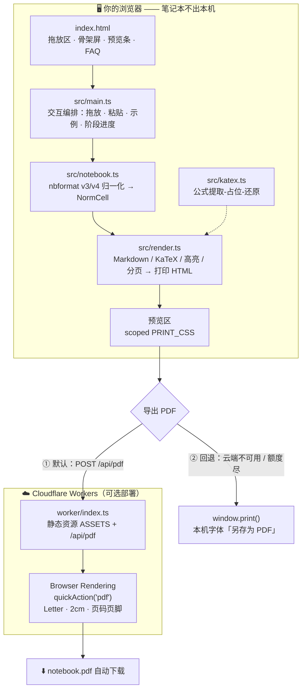
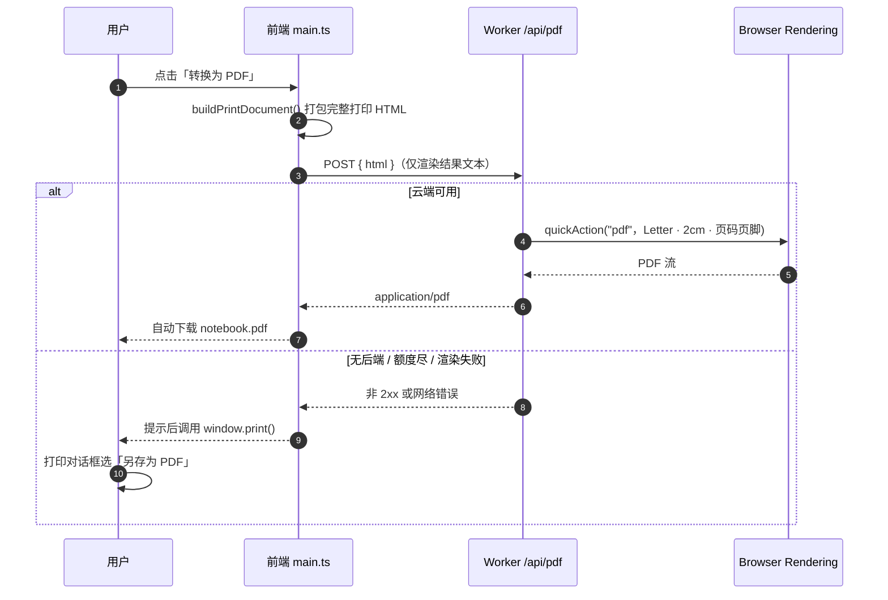

<div align="center">

# 📓 ipynb-to-pdf

**把 Jupyter Notebook 转成中文不乱码的 PDF —— 笔记本文件不出你的浏览器**

*No more tofu boxes □□□ — Jupyter → PDF with first-class CJK support* / TypeScript · Vite · KaTeX · Cloudflare Workers

[](https://www.typescriptlang.org/)
[](https://vite.dev/)
[](https://developers.cloudflare.com/workers/)
[](https://katex.org/)
[](./LICENSE)

[快速开始](#-快速开始) · [架构总览](#-架构总览) · [设计支柱](#-设计支柱) · [核心机制](#-核心机制) · [项目结构](#-项目结构)

</div>

---

## 🎯 这是什么

一份用中文写的 Jupyter 课件/讲义，想转成 PDF 分享，结果：

- `nbconvert` + LaTeX 路线要装 TeX 发行版，中文字体一配错就满屏 **□□□**；
- 在线转换工具要求上传笔记本，课件里可能有不想外传的内容；
- 课件里老师留下的内嵌 HTML（`<font color>`、`<center>`、`<style>`）经常被转没了。

**ipynb-to-pdf 把渲染全部搬进你的浏览器**：拖入 `.ipynb` 即时预览，一键导出 PDF。
因为没有 LaTeX、没有字体子集化环节，正文直接走你本机的中文字体栈，中文天然不乱码；
解析和渲染不离开本机，云端导出（可选）发送的也只是渲染完成的 HTML 文本。

> 它不装 TeX，不装 nbconvert，不上传你的笔记本。
> 转换不运行任何代码——只渲染笔记本里**已经保存**的输出。

## 🏛️ 设计支柱

| 支柱 | 怎么做到的 | 落点 |
|---|---|---|
| 🀄 **中文不乱码** | 渲染在本机浏览器完成，`font-family` 走 PingFang SC / Microsoft YaHei / Noto Sans CJK SC 栈，无字体子集化环节 | `src/render.ts` 的 `PRINT_CSS` |
| 🎨 **Jupyter 原味** | markdown 内嵌 HTML 直通、`In [n]:` 提示符、经典 CodeMirror 配色、输出区独立列 | `src/render.ts` |
| 🔒 **隐私优先** | 解析与渲染全在浏览器；云端导出只上传渲染后的 HTML 文本，且走你自己部署的 Worker | `src/main.ts` · `index.html` FAQ |
| 🛟 **永不卡死** | 云端导出失败（无后端 / 免费额度用完 / 网络错误）自动回退浏览器打印，UI 无感切换 | `src/main.ts` 的 `convertToPdf()` |

## ✨ 功能全景

- 📄 **nbformat v3/v4 双格式归一化** — 老 Anaconda 导出的 v3 笔记本也能转，下游只见一种中间表示（`src/notebook.ts` 的 `parseNotebook`）
- 📝 **GFM Markdown 全要素 + 内嵌 HTML 直通** — 表格、任务列表、`<font>`/`<center>`/`<style>` 原样生效，对齐 Jupyter 行为（`src/render.ts` 的 `markdown-it { html: true }`）
- 🧮 **KaTeX 数学公式** — `$…$` 行内与 `$$…$$` 块级，公式先抽成占位符再还原，不会被 markdown 规则吃掉（`src/katex.ts`）
- 🎨 **代码高亮 + `In [n]:` 提示符** — highlight.js 经典配色，`ipython/sh/console` 等别名自动映射（`src/render.ts` 的 `highlightCode`）
- 🖼️ **图片全收** — nbformat 附件（`attachment:`）、matplotlib base64 输出、OSS/图床外链全部进 PDF（`src/notebook.ts` 的 `normalizeAttachments`）
- 📑 **`<!-- CELL_BREAK -->` 自动分页** — 课件里的分页意图变成真正的分页符（`src/render.ts` 的 `injectPageBreaks`）
- 🧯 **ANSI 控制序列清洗** — stream 输出只留可读文本（`src/notebook.ts` 的 `stripAnsi`）
- 🪄 **交互式 widget 自动跳过** — 计数并提示"N 个 widget 无法进入 PDF"，其余内容正常渲染（`src/notebook.ts` 的 `WidgetCounter`）
- 🖱️ **全窗口拖放 + Ctrl+V 粘贴 + 内置示例** — 任意位置松手即预览，`?example=1` 一键自检（`src/main.ts`）
- ☁️ **一键云端导出 + 打印兜底** — 三阶段进度（发送 HTML → 浏览器渲染 → 生成 PDF），失败无缝回退 `window.print()`（`src/main.ts` · `worker/index.ts`）

## 🏗️ 架构总览



**导出链路时序**（含兜底分支）：



## 🧰 技术栈

| 分类 | 技术 | 用途 |
|---|---|---|
| 语言 / 构建 | TypeScript 5 · Vite 7（**无框架**，零运行时 UI 依赖） | 前端单页与 Worker 同栈开发 |
| Markdown | markdown-it 14（`html: true`） | GFM 渲染 + 内嵌 HTML 直通 |
| 公式 | KaTeX 0.16 | `$…$` / `$$…$$` 排版 |
| 高亮 | highlight.js 11（common 包） | 代码单元格语法高亮 |
| 安全 | DOMPurify 3 | 输出区 / 内嵌 HTML 白名单净化 |
| 图标 | @phosphor-icons/web | UI 图标 |
| 云端导出 | Cloudflare Workers + Browser Rendering + Workers Assets | `/api/pdf` 无头渲染 + 静态托管 |
| 验收 | jsdom（仅 devDependency） | Node 端复用渲染逻辑做验收，不进构建产物 |

## 🚀 快速开始

### 0️⃣ 环境要求

| 组件 | 版本要求 | 说明 |
|---|---|---|
| Node.js | ≥ 20.19（Vite 7 的要求） | npm 随 Node 附带 |
| Cloudflare 账号 | 可选 | 仅「一键云端导出」需要；不用它照样能导出 |

### 1️⃣ 安装

```bash
npm install
```

### 2️⃣ 本地体验

```bash
npm run dev          # 打开 http://localhost:5173
```

> 💡 dev 模式没有 `/api/pdf` 后端，点「转换为 PDF」会自动走浏览器打印——这正是兜底设计的意义：**纯本地也能完成全部导出**。

### 3️⃣ 部署云端导出（可选）

```bash
npx wrangler login   # 登录 Cloudflare（首次会弹浏览器授权）
npm run deploy       # = vite build + wrangler deploy
```

部署完成后 wrangler 会输出 `https://ipynb-to-pdf.<你的子域>.workers.dev`。
Browser Rendering 免费档有每日浏览器时长额度，用完自动回退本地打印，服务不会报错卡死。

<details>
<summary><b>🔧 想在本地起完整 Worker 调试？</b>（点击展开）</summary>

```bash
npm run build
npx wrangler dev     # 本地起 Worker，静态资源 + /api/pdf 一并可用
```

Browser Rendering 绑定在本地通过远程代理连接，首次使用需保持 `wrangler login` 状态。

</details>

### 4️⃣ 体验核心链路

1. 打开页面，把任意 `.ipynb` 拖到**窗口任意位置**（或 `Ctrl+V` 粘贴文件，或点击选择）
2. 检查预览：单元格统计、页数估算；若有交互式 widget 会提示跳过数量
3. 点 **转换为 PDF**：观察三阶段进度（发送 HTML → 浏览器渲染 → 生成 PDF）→ 自动下载
4. 若走兜底路径：在打印对话框选「**另存为 PDF**」，纸张 Letter、边距默认、勾选「**背景图形**」以保留代码块灰底
5. 访问 `http://localhost:5173/?example=1` 用内置示例自检全流程

## ⚙️ 配置说明

| 配置 | 位置 | 默认值 | 说明 |
|---|---|---|---|
| Worker 名称 | `wrangler.json` | `ipynb-to-pdf` | 决定 `*.workers.dev` 子域 |
| 静态资源绑定 `ASSETS` | `wrangler.json` | `./dist` | `vite build` 产物目录 |
| 浏览器绑定 `BROWSER` | `wrangler.json` | BrowserRun | `/api/pdf` 的无头浏览器 |
| 纸张 / 边距 | `worker/index.ts` 的 `PDF_OPTIONS` 与 `src/render.ts` 的 `PAGE_OPTIONS` | Letter / 2cm | **两处需保持一致**（云端与 @page 对齐） |
| 页脚页码 | `worker/index.ts` 的 `footerTemplate` | 第 X 页 / 共 Y 页 | 页眉为空 |
| 请求体上限 | `worker/index.ts` | 25 MB HTML | 超限返回 413，提示拆分笔记本 |

💡 **最低可用配置**：什么都不用改。`npm run dev` + 浏览器打印即可覆盖全部导出需求；云端导出只是锦上添花。

## 🔬 核心机制

### 1️⃣ 为什么中文不会变成 □□□

传统 `nbconvert → LaTeX → PDF` 路径要经过字体子集化，中文字体一缺失就是空白方块。本项目全程走 **HTML/CSS 渲染路径**：正文、代码、公式都是 DOM，字体由一段 CSS 决定（`src/render.ts` → `PRINT_CSS`）：

```css
font-family: -apple-system, "Segoe UI", "Helvetica Neue", "PingFang SC",
  "Hiragino Sans GB", "Microsoft YaHei", "Noto Sans CJK SC", "Source Han Sans SC", sans-serif;
```

渲染发生在你本机浏览器，这些字体你机器上一定有——所以「天然不乱码」。

### 2️⃣ 公式为什么不会被 markdown 吃掉

markdown 规则会把 `$E = mc^2$` 里的 `_`、`*` 当成强调语法。`src/katex.ts` 在 markdown-it 之前插入一道管线：

```
原始 markdown
  → maskProtected()：围栏代码块 / 行内代码 / HTML 注释先保护起来
  → $$…$$ 与 $…$ 抽成占位符 xmathrulez<idx>xmathrulez
  → markdown-it 正常渲染（占位符是普通文本，谁也动不了它）
  → restore()：占位符还原为 KaTeX HTML，失败则显示红色代码兜底
```

### 3️⃣ 内嵌 HTML 怎么做到「原味又安全」

`markdown-it` 开 `html: true` 让课件的 `<font>`/`<center>`/`<style>` 直通（Jupyter 行为）；所有动态内容（输出区 HTML、SVG、公式产物）过一遍 **DOMPurify 白名单**（`src/render.ts` → `sanitize`）：

- 保留课件常用的 legacy 属性：`align` / `face` / `color` / `bgcolor`…
- 剔除打印场景无意义且有风险的东西：`script` / `iframe` / `object` / `embed` / `form` 与 `onerror` 类内联事件

### 4️⃣ 双路导出，永不断头

云端路径把渲染好的完整 HTML POST 到你自己部署的 Worker（`worker/index.ts`），由 Browser Rendering 的 `quickAction("pdf")` 无头渲染成 Letter 纸张 + 2cm 边距 + 中文页码页脚的 PDF 流式返回；任何一环失败（未部署、额度尽、网络错误、返回非 PDF），前端统一 catch 后调 `window.print()`——本机字体、你说了算的纸张边距。**两条路 UI 无感切换，没有死胡同。**

## 📁 项目结构

```text
ipynb-to-pdf/
├── index.html            # 单页 UI：拖放区 / 骨架屏 / 预览条 / FAQ 折叠
├── src/
│   ├── main.ts           # 页面编排：拖放·粘贴·示例·云端转换·打印兜底
│   ├── notebook.ts       # .ipynb 解析：nbformat v3/v4 归一化 + ANSI 清洗 + widget 计数
│   ├── render.ts         # 渲染核心：markdown/KaTeX/高亮/分页 + Jupyter 原味 PRINT_CSS
│   ├── katex.ts          # 公式「提取-占位-还原」管线，防 markdown 吞公式
│   ├── node-render.ts    # 验收专用入口（jsdom 顶替 DOM），不进构建产物
│   └── vite-env.d.ts     # Vite 类型声明
├── worker/
│   └── index.ts          # Cloudflare Worker：静态资源 ASSETS + POST /api/pdf
├── wrangler.json         # Worker 配置：assets + browser 双绑定
├── package.json / tsconfig.json
├── dist/                 # 构建产物（vite build 生成）
└── .acceptance/          # 验收期浏览器 profile 产物，与项目逻辑无关
```

> 💡 每个源码文件开头都有一段中文模块头注释，说明该文件的职责与设计取舍——逐文件精读可直接从 `src/` 打开源码开始。

## 🗺️ Roadmap

- [x] nbformat v3 / v4 双格式支持
- [x] KaTeX 行内 / 块级公式
- [x] `<!-- CELL_BREAK -->` 分页标记
- [x] 图片三类来源全覆盖（附件 / base64 / 外链）
- [x] 云端导出 + 浏览器打印自动兜底
- [x] 全窗口拖放 / 粘贴 / 内置示例
- [ ] A4 纸张与边距自定义（当前固定 Letter + 2cm）
- [ ] 批量多文件转换
- [ ] 暗色打印主题

## 🤝 参与贡献

欢迎 Issue 与 PR：Fork → 新建分支 → 提交改动 → 发起 Pull Request。
改动渲染逻辑时，可用仓库根目录的样例笔记本（`大模型在线API接入基础入门实战.ipynb`）与 `?example=1` 内置示例做对照验证。

<div align="center">

**MIT License** © 2026 ipynb-to-pdf contributors

如果这个项目帮你保住了课件的中文排版，欢迎点一个 ⭐

</div>
